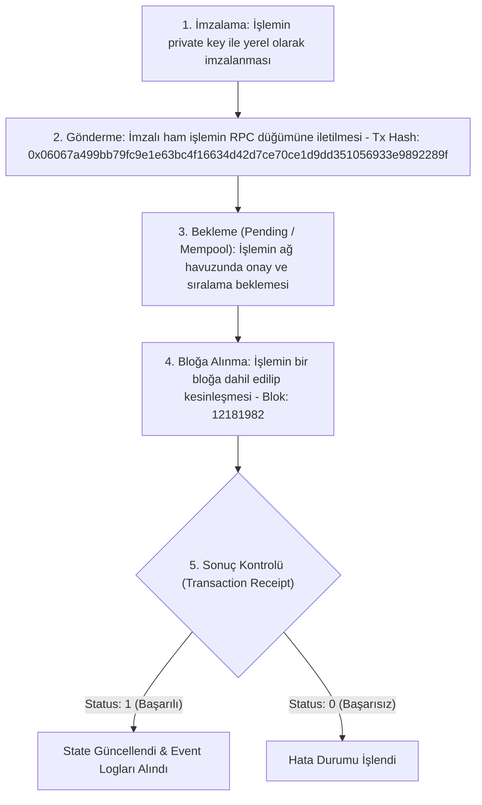
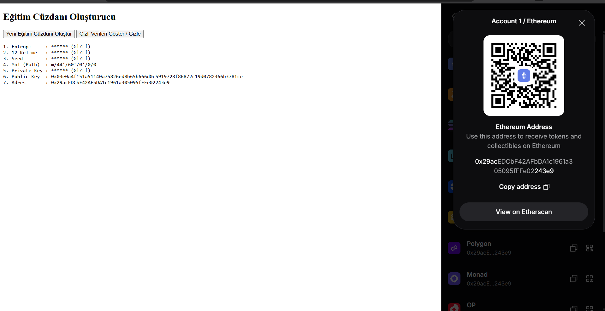
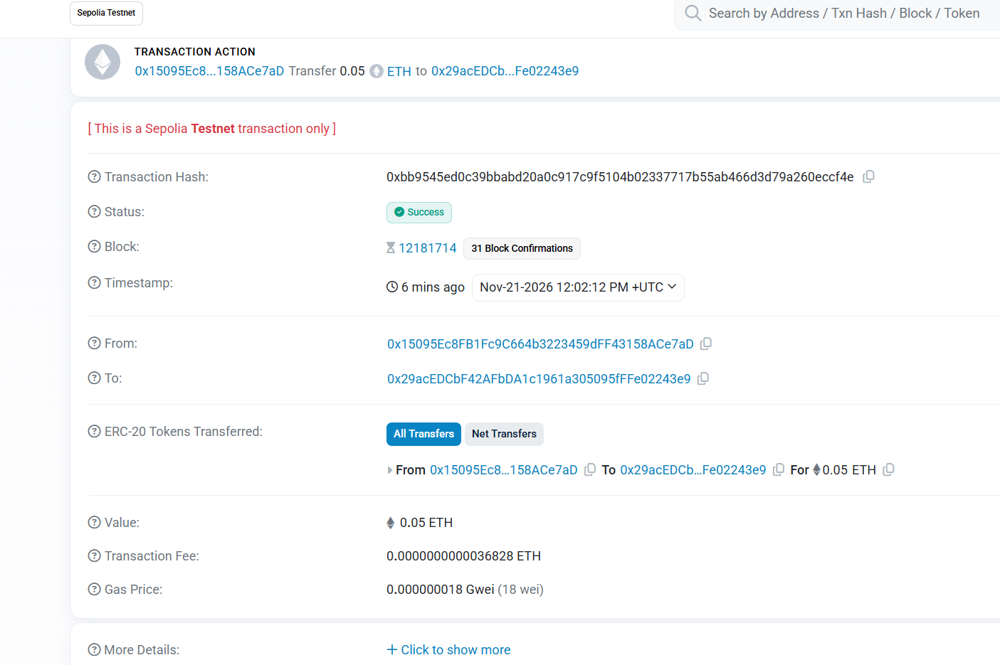
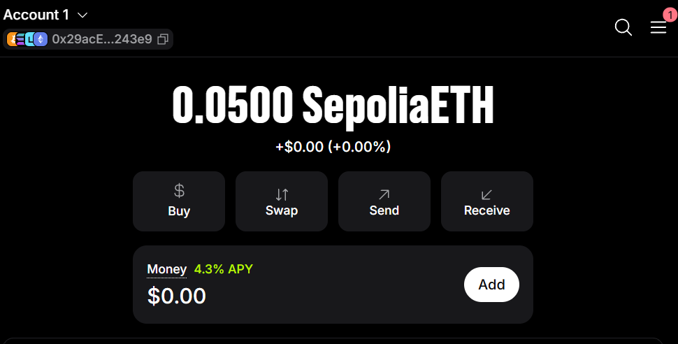
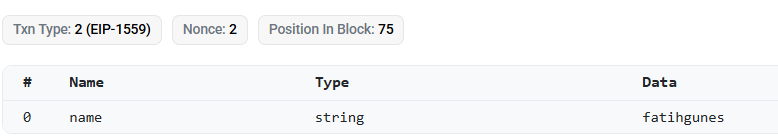
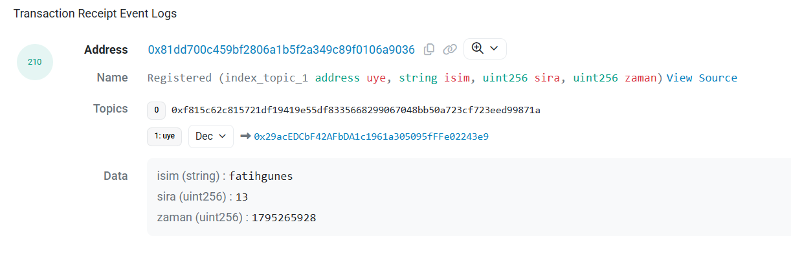
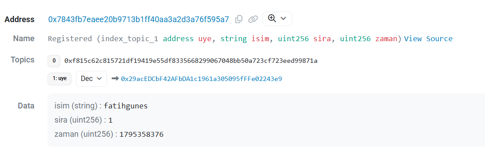

# Blokzincir Temelleri
## İP01  Blokzincir ve Ortak Kayıt

- **Blokzincir, işlem, blok ve dağıtık defter nedir? Birbirleriyle nasıl ilişkilidir?**

**Blokzincir**: verilerin merkezi bir sunucuda bulunmadan, ağa bağlı olan bilgisayarlarda bloklar halinde saklandığı dağıtık bir veritabanı tipidir. Bloklar halinde birbirine bağlandığı bir veritabanı tipidir. Blokzincirdeki veriler bir kez eklendikten sonra değiştirilemez veya silinemez. Eğer ki veride bir güncelleme yapılacak ise yeni blokta yapılır. Yapılan tüm işlemler ağa bağlı olan tüm bilgisayarlar tarafından görülebilir.

**Blok**: Blokzincir yapısındaki verileri, işlemleri kalıcı olarak kaydeden parçalardır. Her bir blok bir önceki bloğun Hash(özet kodu)'nu tutar. Bu durum da bu yapının kısmen "Linked List" yapısına benzediğini gösterir. Blok'un içerisinde veri, zaman damgası, önceki bloğun hash'i tutulur.

Blokzincir sistemini bir **defter** olarak düşündüğümüzde, bu defterin sayfaları bloklardır. Her bir sayfanın orijinali ve önceki sayfanın bir şifrelenmiş özeti bulunur. **Dağıtık defter** sistemi de verilerin merkezcil değil, ağdaki bilgisayarlara eş zamanlı saklanıp doğrulandığı sistemdir.

**İşlem:** Ağ üzerinde gerçekleşen en küçük veri transferi veya durum değişikliği adımıdır. Defter benzetmesinden devam edersek, defterin sayfaları bloklar ise, o sayfalara alt alta yazılan her bir satırlık kayıt da işlemdir.

Kullanıcılar ağ üzerinde işlemler gerçekleştirir. Bu işlemler doğrulanıp bir paket halinde toplanarak bir blok oluşturur. Oluşturulan bu bloklar, hash yöntemiyle şifrelenip sonraki blokta tutulur. birbirleri arasındaki ilişki genel olarak böyle ifade edilebilir.

- **Merkezi veritabanıyla blokzincir arasında kayıt kontrolü ve güven açısından ne fark vardır?**

**Merkezi veritabanında** kayıtların kontrolü tek bir otoritenin (şirket, kurum veya sistem yöneticisi) elindedir. Veriler üzerinde değiştirme, silme veya geriye dönük düzeltme yapma yetkisi tamamen bu otoritededir. Bu sistemde güven, veriyi tutan o merkezi kurumun dürüstlüğüne ve iyi niyetine dayanır, yani kuruma güvenmek zorundasınızdır.

**Blokzincirde** ise kayıt kontrolü merkeziyetsizdir yani ağdaki tüm katılımcılara dağıtılmıştır. Bir kaydın deftere eklenebilmesi için ağdaki bilgisayarların çoğunluğunun ortak onayı gerekir. Veri bir kez şifrelenip eklendikten sonra kimse tarafından değiştirilemez veya silinemez. Bu nedenle blokzincirde güven bir kişiye, yöneticiye veya kuruma değil, doğrudan şifrelemeye ve sistemin kurallarına duyulur.

- **Geçmiş işlemin kaydı ile sözleşmede tutulan güncel değerin değişmesi nasıl ayrılır?**

**Sözleşmede tutulan güncel değer** verinin ağdaki düğümlerde tutulan en güncel halidir. Geçmişteki değerlerle ilgilenmez ve onları bilmez. Akıllı sözleşmelerin bu veriye anlık olarak erişip okuyabilmesi ve tüm nodeların aktif veritabanında (state) tutması nedeniyle maliyeti yüksektir.
**Geçmiş işlemin kaydı** gerçekleşen işlemleri blokzincirin değişmez geçmişine yeni satır (log) olarak ekler. Akıllı sözleşmeler tarafından içeriden okunmadığı ve sadece geçmiş kaydı olarak tutulduğu için maliyeti düşüktür.

- **Bir etkinlik kayıt sisteminde blokzincir kullanmanın yararı ve ek maliyeti ne olabilir?**

*Sistemde blokzincir kullanmanın yararı*; toplantı günü, saati, katılımcıların bilgileri gibi değerler değiştirilemez. Bu nedenle kimse kendi başına birisinin ismini katılımcılar listesine ekleyemez, çoğunluğun onayı gerekir. Kimin ne zaman etkinliğe kayıt yaptırdığı herkes tarafından doğrulanabilir.
*Ek maliyet ve dezavantaj* olarak düşünüldüğünde ise her katılımcının sisteminde tüm etkinliklerin tüm katılımcılarından iz ve veri özeti bulunur. Bu nedenle depolama maliyetleri yüksek olabilir. Ayrıca geleneksel sistemlerde verilerin direkt ve ücretsiz olarak eklenebilmesine karşın, blokzincirde yazılan her isim için bir ücret ödenir.

- **Benim yorumum:** *Hangi durumda normal veritabanını tercih ederdiniz?*

Özellikle verilerin sürekli değişmesi gereken sistemlerde geleneksel veritabanı tercih ederdim. Çünkü sürekli değişmesi gereken bir veri blokzincirde tutuluyorsa zaman ve nakit maliyeti inanılmaz düzeylere ulaşabilir. Örneğin çevrim içi oyunlardaki eşya fiyatları, kahraman özellikleri vs. sürekli değişebileceğinden geleneksel veritabanı daha mantıklı olacaktır.

## İP02 Node ve Konsensüs

- **Node ve validator nedir? Her node blok üretir mi?**

Blokzincir altyapısını oluşturan ve protokol yazılımını çalıştıran her bir cihaza **node** denir. Daha fazla node, daha fazla dayanıklılık anlamına gelir çünkü bir kişinin veya belirli bir kişi grubunun çoğunluk durumuna geçmesi güçleşir.

Blokzincir ağlarında **validatör**; ağ üzerinde gerçekleşen transferleri, işlemleri ve akıllı kontratları doğrulayan, onaylayan ve yeni bloklar üreten kişilerdir.

Her node bir blok **üretmez**. Yalnızca validatör gibi özel düğümler blok üretir.

- **Konsensüs neyi sağlar? PoW ve PoS’un temel yaklaşımları nasıl farklılaşır?**

**Konsensüs**: Önceki başlıklardaki çoğunluğun fikir birliğiyle eklenecek verilere, yapılan işlemlerin geçerliliği gibi konulara karar verilmesi sürecidir.
**PoW/PoS**: blokzincir ağlarında işlemleri doğrulamak, güvenliği sağlamak ve zincire yeni bloklar eklemek için kullanılan bir konsensüs mekanizmalarıdır.
PoW mekanizmasında madenciler yeni bir blok oluşturmaya çalışır. Bunun için karmaşık problemleri çözmek zorundadırlar ve bunun için yüksek güçte donanımlar gerekir ve elektrik maliyetleri yüksek olabilir.
PoS mekanizmasında ise validatörler, işlem onayına katkı ve ödüllendirme için sisteme belirli düzey varlıklarını kilitlerler. Dürüst olan katılımcılara ödül, olmayanlara ise kilitledikleri varlıklardan kesinti yapılır.

- **Public/private ve permissionless/permissioned ağ kavramları hangi özellikleri anlatır? Okuma, işlem gönderme ve doğrulayıcı olma izinlerini ayırın.** 

**Public Ağ:** Public ağdaki tüm verileri herkes okuyabilir, herkes ağa işlem gönderebilir.
**Private Ağ:** Verilerde işlem yapmak, yeni veri eklemek, okumak için yetki almak gerekir. Yetkisiz kişilere bu işlemler kapalıdır.
**Permisionless Ağ:** Bu ağlarda isteyen herkes protokol yazılımını indirip onay gerekmeden validator olabilir.
**Permissioned Ağ:** Bu ağlarda ise sadece konsensüs yetkilileri tarafından izin sağlanan, yetkili node'lar validatör olabilir.

- **İşlemin bloğa alınması, başarılı çalışması ve kesinleşmesi neden farklıdır?**

İşlemin bloğa alınması sürecinde bir validatör işlemi havuzdan alıp bloğa dahil eder.
Başarılı çalışması ise bloğa alınan işlemin kod içinde hata vermeden tamamlanması sürecidir; çünkü işlem hata verip başarısız olsa bile bloğa girip gas ücreti ödeyebilir.
Kesinleşmesi sürecinde ise ağa sunulan bloğun, validatörlerin çoğunluğu tarafından konsensüs sağlaması durumunda işlem kesinleşir ve geri dönderilemez hale gelir.

**Benim yorumum: Tek bir node kapanınca bütün ağın durup durmayacağı neye bağlıdır?**

Ağın devamlılığı yeterli validatör sayısının sağlanıp sağlanmadığına ve o node'un ağ üzerindeki görevine bağlıdır. Normal bir full node kapanırsa ağ etkilenmez çünkü veriler zaten diğer nodelarda da kopyalıdır. Ancak aktif validatör sayısı çoğunluk (konsensüs) sağlanamayacak kadar azalırsa ağ yeni blok üretemez ve durur.

# Cüzdan Varlık ve Sözleşme Kavramları 
## İP 03: Kriptografi ve Cüzdan 

- **Hash, şifreleme ve dijital imza hangi farklı amaçlarla kullanılır?**

*Hash*, verileri toplar ve benzersiz bir dijital parmak izine dönüştürür. Verideki en ufak değişiklik hash'i tamamen değiştirir. Blokları birbirine bağlamak için kullanılır. 
*Şifreleme*, okunabilir verileri yetkisiz kullanıcıların çözemeyeceği şifreli metinlere dönüştürür ve sadece anahtara sahip kişiler metne erişebilir. Bu durum güvenliği sağlar ve kötü amaçlı şahısların önemli verilere erişimini engeller.
*Diğital imza*, Şifreleme(Kriptografi) ile hash'in birleşimidir. Gönderici, işlemi imzalamak yerine önce hash özetini çıkarır ve sonrasında imzalar.

- **Private key, public key, adres, mnemonic ve seed arasındaki ilişki nedir**

Bu kavramlar, tek yönlü bir türetme zinciri oluşturur (Mnemonic -> Seed -> Private Key -> Public Key -> Adres). Baştaki veri bilindiğinde sonraki veriler de aynı şekilde hesaplanır ancak son hali bilinen veriyi geriye döndürmek imkansızdır. Bu zincirin en sonunda ise ortaya cüzdan adresi çıkar.

- **Entropi ve checksum ne işe yarar? BIP39, BIP32 ve BIP44 hangi aşamalarla ilgilidir?**
Cüzdan oluşturma sırasında entropi güvenlik temelini, checksum hata kontrolünü sağlar. BIP39 entropiden kurtarma kelimelerinin (mnemonic) oluşturulmasıyla, BIP32 tek bir seed'den hiyerarşik anahtar türetilmesiyle, BIP44 ise farklı coin ve hesapların standart türetme yollarıyla ilgilidir.
*Entropi*: Cüzdanın tahmin edilemezliğini sağlayan binary veridir. Rastgele sayı üretici ile 128 veya 256 bit şeklinde üretilir ve bu nedenle herhangi birinin aynı cüzdanı üretebilmesi matematiksel olarak mümkün değildir.
*Checksum*: Kullanıcı kelime listesini veya cüzdan adresini girerken yanlış bir harf yazdığında sistem bunu fark eder ve geçersiz uyarısı vererek hatalı adrese para aktarımını engeller.

**Cüzdan uygulaması ile hesap aynı şey midir? Adresi paylaşmakla anahtarı paylaşmak neden farklıdır? Adres paylaşımının mahremiyet etkisi var mıdır?**
Cüzdan uygulaması ile hesap aynı şey değildir. Hesap, blokzincir üzerinde bakiyesi ve adresi bulunan kaydın kendisidir. Cüzdan uygulaması (örneğin MetaMask) ise sadece bu hesaba ait private keyleri saklayan, işlem imzalamamızı ve ağa bağlanmamızı sağlayan bir arayüz yazılımıdır.

Basit bir benzetme yaparsak cüzdan adresi paylaşmak IBAN paylaşmak gibidir. İnsanlar para gönderebilir ancak hesabınıza ve işlemlerinize erişim sağlayamaz. Anahtar paylaşmak ise hesabınıza erişim izni vermektir. Benzetme yapacak olursak banka şifrenizi paylaşmaya benzer. Tüm varlıklarınız çalınabilir ve hesabınızla her işlemi yapabilirler.

Adres paylaşımı ciddi mahremiyet problemlerine sebep olabilir. Çünkü adresinizi halka açık yapacak olursanız hesap geçmişiniz ve yaptığınız tüm işlemler herkes tarafından erişilebilir hale gelir.

**Benim yorumum: Cüzdan uygulamasının silinmesiyle kurtarma bilgisinin kaybolmasını karşılaştırın**

Cüzdan uygulaması silinse dahi cüzdanın verileri blokzincirden silinmeyeceği için geri alınabilir. Ancak kurtarma anahtarı olmazsa hesaba erişim sağlanamayacağından geri döndürülemez şekilde varlıklar hesapla birlikte blokzincir içinde erişim sağlanamaz şekilde kalır.

## İP 04: Bitcoin Ethereum ve Token

**Bitcoin ve Ethereum’un temel amaçları ve programlanabilirliği nasıl farklılaşır?**

Bitcoin'in temel amacı geleneksel bankalar gibi merkezi bir sisteme ihtiyaç duymadan para transferi yapılmasıdır. Bitcoin, para birimi olmak üzere tasarlanılmıştır.
Ethereum ise para birimi olmak ve transfer sağlamaktan ziyade merkeziyetsiz uygulamaların ve akıllı sözleşmelerin çalıştırılabildiği programlanabilir bir yazılım platformu olmak üzere geliştirilmiştir.
Bitcoin daha çok para transferi gibi işlemler için olduğundan programlanabilirliği onunla kısıtlıdır. Ancak ethereum, programlama platformu olması nedeniyle uygulamalar vs. geliştirilebilir.

**Native varlık ve token nedir? ETH ve USDC üzerinden açıklayın.**

*Native varlık;* doğrudan bir blokzincir ağının protokolleri ile üretilen varlıktır. Buna örnek olarak ETH verilebilir. ETH, Ethereum protokolünün bir parçasıdır ve bir tokeni değildir.
*Token;* Kendi blokzinciri olmayan, farklı bir blokzincir ağındaki bazı standartlara uygun yazılan akıllı sözleşmeler ile üretilir ve dağıtılır. Örnek olarak USDC verilebilir. USDC, Ethereum ağında ERC-20 sözleşmesi olarak tanımlanmıştır. 
ETH transferi yapıldığında protokol doğrudan kullanıcının bakiyesini azaltıp gönderilenin bakiyesini arttırır. USDC transferi yapılıyorken ise akıllı sözleşmeye bağlanıp transferi gerçekleştirir. Transfer ücreti yalnızca ETH üzerinden alınır.

**Stablecoin, NFT ve ERC-20 kavramları neyi ifade eder?**

*Stablecoin*, isminden de anlaşılacağı üzere değerini ABD doları, Euro, altın gibi geleneksel bir varlığa endeksleyerek kripto paralardaki yüksk fiyat dalgalanmalarını minimuma indirmeyi amaçlar.
*NFT* ise patentlere benzer. Fiziksel veya dijital varlığın orijinalliğini teyit eder ve kanıtlayan sertifikadır.
*ERC-20*; Ethereum zinciri üzerinde oluşturulacak tokenların uyması gereken kuralların tümüdür.

**Mainnet ve testnet neden ayrılır? Test ETH ve test USDC gerçek varlıklarla aynı ekonomik değeri taşır mı?**

*Mainnet:* Bir blokzincir'in gerçek işlemlerinin yapıldığı, herkese açık(public) ve tamamen çalışan sürümüdür.
*Testnet:* Ana ağın kopyası gibi çalışır ancak üzerindeki tokenların ve varlıkların gerçek değeri olmayan deneme ağıdır.
Test ETH ve test USDC gerçek varlıklarla aynı değeri taşımaz. Çünkü bunlar test native varlık ve test tokenlerdir. O nedenle genelde ücretsiz olarak alınırlar ve ekonomik değerleri gerçekle aynı değildir.

**Benim yorumum: Etkinliğe giriş hakkını temsil etmek için mutlaka token gerekir mi?**

Hayır, bence etkinliğe giriş hakkı sağlamak ve temsil etmek için illaha token kullanımı gerekmez. Giriş sağlanması için cüzdan adresleri kullanılabilir ve böylece herhangi bir tokena gerek kalmaz.

## İP 05: Akıllı Sözleşme ve ABI 

**Akıllı sözleşme, EVM ve state nedir**

*Akıllı sözleşme;* Blokzincir ağında depolanan, koşullar sağlanınca otomatik çalışan kod parçalarıdır. Akıllı sözleşmeler programlamadaki if fonksiyonlarına benzer. Geliştiriciler akıllı sözleşmeler aracılığıyla blokzincir üzerinde kod yazabilir.
*EVM* bu akıllı sözleşmeleri uyumlu blokzincirlerin üzerinde tutarlı ve güvenli şekilde çalışmasını sağlayan bir sanal bilgisayardır.
*State*, blokzincir üzerindeki tüm hesapların bakiyelerini, akıllı sözleşmeleri gibi verileri gösteren veri tabanıdır.

**Kaynak kod, derleme ve bytecode nasıl ilişkilidir? Deploy ne yapar?**

*Kaynak kod:* Geliştiricilerin blokzincirdeki kuralları ve mantığı yazmak için kullandığı kodlardır. Bu kodlar belirli bir programlama dili üzerinde yazıldığından(örneğin solidity) okunabilirdir.
*Derleme:* Klasik programlama dillerindeki compilerlar gibidir. Yazılan kaynak kodları blokzincir makinesinin anlayabileceği komutlara dönüştürülmesi işlemidir.
*Bytecode:* Derleme işlemi sonrasında oluşan, makine dilindeki yani sadece blokzincir sanal makinesinin okuyabildiği hexadecimal formattaki kodlardır.
Aralarındaki ilikli; Kaynak kodu geliştirici yazar ve derleyiciye gönderir. Derleyici kodu işler ve kaynak kod en son bytecode haline dönüşür. Deploy işlemi ise derlenen bu bytecode'u bir işlemle blokzincir ağına gönderip sözleşmeye özel bir adres oluşturarak yayına alır.

**ABI ne işe yarar? Ne zaman elde edilir? Bir sözleşmenin adresi dışında hangi arayüz bilgilerine ihtiyaç duyabilirsiniz?**

*ABI:* Blokzincir üzerindeki derlenmiş bytecode ile dış dünya ile iletişim kuran json formatındaki arayüz haritasıdır.
 ABI dosyası, akıllı sözleşmenin kodu derlenildiği anda, sözleşme henüz ağa yüklenmeden ortaya çıkar. 
Sözleşmenin adresi yalnızca sözleşmenin blokzincir üzerindeki konumunu verir. Sözleşmeyle iletişim kurabilmek için ABI dosyası veya çağrılabilecek bir fonksiyonun imzası gerekir.

**Veri okumak ile state değiştiren işlem göndermek nasıl ayrılır?**

Blokzincir ağındaki her düğüm, defterin bir kopyasını bulundurur. Veri okumak defterde hiçbir değişiklik yaratmayacağından diğer düğümlerin onayına gerek duyulmaz, istemci sadece tek bir düğüme bağlanır.
State değiştirme işlemi(bakiye güncelleme, kayıt değişimi...) sürecinde ağdaki tüm nodeların elindeki defter kopyasının güncellenmesi demektir. Yani bu işlemi tek bir düğümde gerçekleştirmek mümkün değildir. Tüm ağa duyurulur, validatörler tarafından doğrulanır ve bloğa yazılır.
Aynı zamanda veri okuma maliyeti sadece işlemi gerçekleşenin işlemcisini anlık kullanacağından ücretsizdir ancak state değiştirme tüm düğümlere dağılacağından maliyet gereği ücretlidir

**Kaynak kodu verify etmek neyi doğrular? Güvenlik denetimiyle aynı şey midir?**

Kaynak kodu verify etme(doğrulama) işlemi, kaynak kodunun derleyiciyle makine dili(bytecode)'a çevrildikten sonra geliştirici kaynak kodunu ve oluşan bytecode'u blokzincir tarayıcıya yükler, kaynak kod tekrar derlenip önceden oluşan bytecode ile karşılaştırılması işlemidir.
Güvenlik denetimi ile aynı şey değildir. Güvenlik denetimi, koddaki mantık hataları, siber saldırıya karşı zaafiyetler gibi problemlerin olup olmadığının kontrolü sürecidir.

**Benim yorumum: Aynı kod iki farklı adrese yayınlanınca kayıtları neden ayrı olabilir?**

Kodlar farklı adreslerde olduğundan kodlardaki işlemlerin uygulanacağı veriler de farklı olur. Bu nedenle kayıtları ayrı olabilir.

# Ağ Erişimi İşlemler ve Ekosistem 

## İP 06: RPC Explorer ve Event 

**RPC ve RPC endpoint nedir? Node ve RPC hizmet sağlayıcısı ile ilişkileri nasıldır?**

RPC(Remote Procedure Call): Cüzdanlar, uygulamalar ve hizmetlerin node ile iletişim kurmasını sağlar. RPC ile hesap bakiyesi görüntüleme, işlem gönderme, blok zincir geçmişini görme gibi çeşitli işlemler yapılabilir.

RPC Endpoint: Cüzdanların ve uygulamaların blokzincir ağıyla iletişimini sağlayan adrestir.
Uygulama veya cüzdan, blokzincirle direkt iletişim kuramaz. Bunun için bir node'a bağlanması gerekir. Uygulama, isteğini RPC Endpointine gönderir, sık sorulan veri ise önbellekten döndürür, değilse işlemi node'a yöneltir. Node, iletilen bilgiyi okur veya işlemi validatörlere yayınlar. Sonuç uygulamaya iletilir.

**Block explorer nedir? Explorer’ın veya bir RPC adresinin kapanması ağın durduğunu gösterir mi**

*Block Explorer:* Blokzincir ağındaki tüm işlemleri, adresleri, verileri... herkesin görüntülemesini sağlayan bir arama motorudur.
Explorer’ın veya bir RPC adresinin kapanması ağın durduğunu göstermez. Ağı ayakta tutan şey validatörler ve full node'ların kendi aralarındaki iletişimidir(P2P). RPC sağlayıcısının sunucuları çöktüğünde sadece o kapı kapanır. Blokzincir ağı durmaz. Aynı şekilde explorerların durması da ağın durduğunu belirtmez. Sadece veri okunamaz hale gelir.

**Event/log ile sözleşmenin güncel state’i nasıl ayrılır? Indexer ne işe yarar?** 

State sadece en güncel durumu tutar ve bilir. Geçmiş işlemleri bilmez. Event/Log ise geçmişte gerçekleşen işlemlerin ve olayların kaydını tutar; bu geçmiş kayıtlar baştan sona takip edilerek güncel duruma da ulaşılabilir.
Blokzincirde sql gibi sorgu yapılamaz. "Yani şu cüzdanda yapılan son 1 aydaki işlemleri getir" gibi kolayca sorgu yapılamaz çünkü bu eventler milyonlarca bloğa dağılmış durumdadır. Indexer, yapılan eventlerin hepsini bir bir yakalayıp klasik SQL veritabanına kaydeder. Böylece sorgu yapılabilir.

**Benim yorumum: Explorer olmadan bir kaydı kontrol etmek için hangi yolu araştırırdınız?**

Explorer yoksa uygulama ile ağın konuştuğu RPC'ye sorgu gönderirdim.

## İP 07: Bir İşlemin Yolculuğu 

**Cüzdan bağlamak, mesaj imzalamak ve işlem göndermek hangi farklı işlemlerdir**

Cüzdan bağlamak uygulamaya yalnızca cüzdanın adresini iletir ve sadece okuma izni verir. Bakiyenizi ve işlem geçmişinizi görüntüleyebilir ancak değiştiremez veya herhangi bir işlem yapamaz. Ücret(gas fee) gerekmez.

Mesaj imzalamak ise blokzincire herhangi bir veri yazmadan, bir metnin sizin amahtarınızla onaylandığını kanıtlama işlemidir. Gas fee gerekmez

İşlem göndermek ise blokzincirin durumunu değiştiren ve tüm nodelara yayınlanan komuttur. Token göndermek gibi işlemler örnek verilebilir. Tüm nodelarda ve blokzincirde değişim gerektirdiğinden gas fee gerekir.

**Gas limit, gas used, işlem ücreti, nonce ve chain ID ne işe yarar?**

*Gas limit*, bir işlem için harcanması göze alınan maksimum yakıttır. Akıllı sözleşmelerde işlemin bozulup sonsuz döngüye girebilmesi durumunda alınan bir güvenlik önlemidir.

*Gas used*, işlem gerçekleştikten sonra tüketilen toplam yakıt miktarıdır.

*İşlem ücreti(gas fee)*, işlem tamamlandıktan sonra ödediğiniz fiyattır.

*Nonce*, Cüzdandan yapılan işlemlere sıra numarası verilmesi işlemidir. İşlemin sebebi sizin yaptığınız işlemi birisinin kopyalayıp aynısını tekrarlamasını önlemektir.

*Chain ID*, Blokzincir ağlarının kendilerine özgü kodlarıdır. Bu kodlar yapılan işlemlere dahil edilir böylece test ortamında yapılan işlemler gerçek blokzincir ağında tekrarlanamaz.

**Txid/transaction hash, sözleşme adresi ve block hash neyi tanımlar?**

*Txid/transaction hash,* Ağa gönderilen bir işlemin takip numarasıdır. 
*Sözleşme adresi,* Bir akıllı sözleşmenin blokzincir üzerindeki çalıştığı konumu belirtir. 
*Block Hash,* doğrulandıktan sonra zincire eklenen bir bloğun şifrelenmiş izidir.

**Pending, receipt ve status nedir? İşlem hash’i neden tek başına başarı kanıtı değildir**

Bir işlemi ağa yayınladığınızda önce işlem bellek havuzuna alınır. Bu durumdayken işlemin durumuna pending denir.
Receipt, türkçe karşılığındakine benzer bir işlem gerçekleşip bloğa dahil edildikten sonra üretilen raporudur.
Status, receiptin içerisinde yer alan ve işlemin çalışıp çalışmadığını belirtir. Status 1 işlem başarılı, 0 ise başarısız demektir.
İşlem hash'i yalnızca işlemin nodelar tarafından alınıp mempool'a eklenildiğini belirtir. İşlemin çalışıp çalışmadığına, hatta bir bloğa dahil edilip edilmediğine dair bilgi dahi edinilemez.

**"İşlem başarısız” ile “sonucunu öğrenemedim” neden farklıdır?**

İşlem başarısız ise durum kesindir. İşlem bir sebepten gerçekleşememiştir. Sonucu öğrenememe durumunda ise işlem gerçekleşmiş de olabilir, bekliyor da olabilir. Çünkü sonucu öğrenememe durumunda işlem RPC düğümüne gönderilmiş ama takip kaybedilmiş yahut RPC düğümü çökmüş olabilir.

## İP 08: Ekosistemi Tanı 

**Web3, L1/L2, DeFi, DAO, oracle, bridge ve zero-knowledge proof (ZK) kavramlarını birkaç cümleyle açıklayın.**

*web3*; blokzincir ve merkeziyetsiz ağlar üzerine kurulmuş internet vizyonudur. Şu anda kullanılan uygulamalarda vs çoğunlukla web2(etkileşimli komut) kullanılır.
*L1*; Blokzincirin ana, verilerin depolanıp doğrulandığı temel ağıdır.
*L2*; Blokzincire eklenecek her işlemi ayrı ayrı eklemektense L2(layer 2) işlemleri paketler ve öyle L1'e işler.
*DeFi*; Önceki iş paketlerinden bildiğimiz akıllı sözleşmeler aracılığıyla yürütülen finansal sistemlerdir. Borç verme, kredi çekme vs gibi işlemler akıllı sözleşmelerle bu ekosistemde yapılabilir.
*DAO*; Bir otorite altında blunmayan, topluluk tarafından yönetilen, kurallarının blokzincirdeki akıllı sözleşmelerde tutulduğu organizasyondur. Amaçları krito para protokollerini yönetmek, toplulukları koordine etmek gibi işlemlerdir.
*Oracle*; Dışarıya kapalı blokzincir ağları ile dış dünya arasında veri alışverişi sağlar. Örneğin dolar bazlı bir kripto paranın dolar fiyatını öğrenmesi için gereklidir. Tüm nodelar aynı anda dolar fiyatını işler ve böylece anlaşmazlık olmaz.
*Bridge*; Birbirinden bağımsız iki blokzincir arası veri ve bilgi aktarımını sağlayan protokoldür.
*ZK*; blokzincirde bir tarafın elindeki bilginin doğruluğunu karşı tarafa bilgiyi iletmeden doğruluğunu kanıtlamasını sağlayan bir yöntemdir.

**Dijital kimlik, gerçek dünya varlıklarının temsili (RWA) ve fiziksel altyapı ağları (DePIN) için birer kullanım örneği bulun**

Nüfus müdürlüğü, ehliyet ve kimlik bilgilerini kriptografik şekilde mühürleyip dijital cüzdanına bir kez gönderir, araç kiralayacağın zaman kiralama şirketine gidildiğinde şirket dijital imzayı kontrol eder ve belgenin doğruluğunu anlar, ZK sayesinde ise akıllı sözleşme aracılığıyla kiralama şirketine sadece "Bu kişi 18 yaşından büyük ve 2 yıldan fazla süredir ehliyeti vardır." şeklinde bilgi verilir. TC no veya doğum tarihi paylaşmaya gerek kalmaz.

Değeri yüksek bir gökdelenin yasal bir şekilde blokzincir üzerinde birçok tokene bölünür. Yatırımcılar binanın tamamını alamayacak olsa dahi küçük tutarlarla tokenlar alabilir. Aynı zamanda akıllı sözleşmeler ile kardan payları otomatik dağıtılabilir. Bu RWA'ya örnektir.

Telekom şirketleri milyarlarca dolar harcayıp baz istasyonu kurmasından ziyade gönüllü bireyler evlerine küçük hotspot cihazları kurar ve çevrelerindeki cihazlara bağlantı sağlar. Bu bireyler sağladıkları kapsama alanına göre blokzincirde doğrulandıktan sonra tokenlarla ödüllendirilirler. DePIN'e örnektir.

**ZK ile neyin kanıtlandığını ve hangi bilginin saklanabildiğini basit bir örnekle anlatın. “ZK kullanılıyor” ifadesi bütün işlemlerin gizli olduğu anlamına gelir mi?**

ZK ile bir bilginin veya işlemin doğruluğu kanıtlanır. Örneğin bir yaş doğrulama sitesi olsun. Kullanıcı, kimlik bilgilerini açıkça paylaşmak yerine, cüzdanında ürettiği bilgi ispatını(18 yaşından büyük olmak) siteye sunar. Doğrulayıcı akıllı sözleşme aracılığıyla kullanıcının doğum tarihini görmeden kriptografik kanıtı matematiksel olarak doğrulayarak 18 yaşından büyük olduğunu teyit eder. 
ZK'nın kullanılıyor olması tek başına veri gizliliğini belirtmez. ZK, ağ hızlandırmak ve maliyet düşürmek için de kullanılır. Bu, ağ dışında sistem oluşan işlemleri hesaplar ve bittiğinde tüm işlemin kurallara uygun olduğunu validity proof ile matematiksel olarak kanıtlar. Bu işlem sırasınca ağ yorulmaz.

**Benim yorumum: Hangi alanı daha sonra öğrenmek istersiniz ve neden?**

Kesinlikle optimizasyon kısmını daha sonralarda öğrenmek isterim. Tüm sistemin nasıl çalıştığını, temellerini iyice kavradıktan sonra o sistemi daha hızlı ve daha ucuza çalıştırmayı öğrenebileceğimi düşünüyorum. 

# Proje ve Yarışma Araştırması

## İP 09: Gerçek Bir Blokzincir Projesini İncele

**Bir gerçek blokzincir projesi seçin; resmî sitesi ve dokümantasyonunu bulun**

Nano blokzincirini seçtim.
Resmi site: https://nano.org/
Dökümantasyon: https://github.com/nanocurrency/nano-node

**Hangi problemi, kimler için çözdüğünü açıklayın. Zincirde yapılan işlemlerle zincir dışındaki hizmetleri ayırın.**

Nano, kripto para transferleri gibi işlemlerde yüksek işlem ücretleri, yavaş onay süreleri ve yüksek enerji tüketimine çözüm olarak üretilmiştir. Genel kullanıcılardan uygulama üreticilerine kadar herkes uygulamayı kullanır. Çünkü çözdüğü problem evrensel bir problemdir. 
Nano blokzinciri, geleneksel blokzincirlerden farklı çalışır. Blokzincirin temel mantığı her hesabın kendi blokzincirinin olmasıdır. Zincirde bakiye güncelleme, para gönderme işlemleri yapılır. Zincir dışında ise bakiye görüntüleme, iş kanıtı(PoW) gibi işlemler yürütülür.

**Neden blokzincir kullandığını ve normal bir veritabanıyla yapılsaydı neyin değişeceğini değerlendirin.**

Blokzincir kullanılma sebebi, farklı ülkeler arası varlık transferinin yavaşlığı ve yüksek işkem ücretinden kurtulmaktır. Normal veritabanı kullanılsaydı, bu transferler çok daha pahalı ve yavaş gerçekleşirdi.

**Kullanıcının yöneticiye, işletmeciye veya veri sağlayıcısına hangi konularda güvendiğini belirtin**

Kullanıcı, oy ağırlığıyla seçilen temsilcinin ve ağdaki oy çoğunluğunun sahte işlemleri reddedeceğine güvenir.
Kullanıcı, temsilci düğüm sunucularının kesintisiz açık olmasına güvenir.
Kullanıcı, cüzdanlarının bağlandığı RPC sunucularının kullanıcıya doğru bakiye gösterdiğine ve işlem geçmişini çarpıtmadığına güvenir.

**Projenin bir güçlü tarafını ve bir sınırlamasını kendi görüşünüzle yazın**

Projenin güçlü tarafı tabii ki işlem ücretinin olmayıp çok hızlı çalışmasıdır.
İşlem ücretinin olmaması aynı zamanda bir zayıflık getirebilir. Ethereum gibi blokzincirlerde işlem ücretinin olması, sahte işlemlerle ağı meşgul etmeyi inanılmaz derecede maliyetli yapar. Ancak nano'da işlem ücreti bulunmadığından, kötü amaçlı kullanıcılar ağa miyonlarca sahte işlem gönderip, ağda gecikmelere ve veritabanının büyümesine yol açabilir.

## İP 10: Blokzincir Yarışması Şartnamesini İncele

**Yarışmanın çözülmesini istediği genel problemleri ve takımın geçmişte hedeflediği kapsamları özetleyin**

Blokzincir teknolojisi, merkeziyetsiz teknolojisi ve değiştirilemez yapısı gibi birçok özelliği ile gelecek vaat eden bir teknolojidir. Yarışmanın sebebi ise Türkiye'de bu teknolojiye karşı ilgi ve bilgi birikimi sağlayıp, sadece bu teknolojinin kullanıcısı olmaktan çıkıp bu teknolojinin üreticisi konumunda da Türkiye olarak bulunmayı amaçlamaktadır. 
Takım, geçen sene HALOCLINE projesi ile yarışmada 3.'lük yakaladı. Bu sistem işletmelerin izole çalışan ödeme gibi sistemlerini blokzincir teknolojisi ile buluşturarak daha şeffaf, güvenilir bir sistem kurmayı amaçlamıştır. Ayrıca takım, yalnızca yarışma için değil, gerçek hayatta da kullanılabilir, ticari sistemlere entegre edilebilir sistemler kurmayı amaçlamıştır.

**Anlamadığınız kavramlar varsa; araştırıp kısa biçimde açıklayın**

DLT(Distributed Ledger Technology) : Dağıtık defter teknolojisi, blokzincir teknolojisinin de bir alt dalı olan merkeziyetsiz teknoloji türüdür.
Sidechain: Ana blokzincire paralel ancak bağımsız ayrı bir blokzincir ağıdır. Temel amacı ana zincirin yükünü azaltmaktır.
MPC: DLT ağlarındaki dijital varlık ve anahtarların güvenliğini sağlayan kriptografik yöntem.

**Benim yorumum: Bu programda öğrendiğiniz hangi konuların yarışmada daha çok işe yarayacağını düşünüyorsunuz?**

Fikrimce çok fazla terim ve teorik bilgi olmasına rağmen bunlardan ziyade temel mantığı görsel olarak kafada oturtmanın daha çok işe yarayacağını düşünüyorum. Örneğin validatörler, düğümler bloklar arası ilişkiler, akıllı sözleşmelerin nasıl çalıştığı ve nasıl akıllı sözleşme temelli uygulamalar yapıldığı gibi noktaları anlamak temel olmasına karşın en çok işe yarayacak nokta olabilir.

# Uygulama İçin Çalışma Ortamı

## IP11 Çalışma Ortamını Hazırla

**Git, GitHub, README, commit ve push kavramlarını birkaç cümleyle açıklayın**
Git: Kodların her değişikliğini kaydeden bilgisayar üzerinde çalışan uygulamadır. Git ile uygulama bozulması durumunda eski sürümlere dönebilirsiniz.

GitHub: Kullanıcıların yazdığı kodları açık veya gizli şekilde bulutta saklayıp yönetebilmesini sağlayan sitedir.

README: Projenin nasıl çalıştığını, nerede çalıştırılması gerektiğini ve neyi amaçladığı gibi konuları ele alan metin belgesi.

commit: commit komutu oyunlardaki save almakla benzerdir. Dosyanızın son durumunu alıp git deposuna kaydeder.
it 
push: En son kaydedilen depodaki dosyayı github'a yollar.

**Remix IDE ve Solidity’nin ne işe yaradığını 1–2 cümleyle açıklayın**
Remix IDE: Ethereum gibi blokzincirlere akıllı sözleşme yazmak için kullanılan bir geliştirme uygulamasıdır.
Solidity: EVM uyumlu blokzincir ağlarında akıllı sözleşme yazmak için kullanılan üst düzey programlama dilidir.

**Benim yorumum: Hangi araç size yeniydi? Kurulumda nasıl ilerlediniz**
Remix IDE'yi daha önce kullanmadım aynı zamanda MetaMask da kullanmamıştım diğer araçlar zaten mevcuttu.

# Kendi Cüzdanını Oluştur ve Doğrula

## İP12 Kendi Cüzdan Oluşturucunu Yaz

Burada çok basit bir html oluşturdum çünkü tasarımla ekstra kütüphane ve kod kalabalığı yapmak istemedim. Sadece klasik butonlar ve fonksiyonlar bulunacak.

**her dönüşümün görevini ve kullanılan kütüphane çağrısını açıklayın.**

*window.crypto.getRandomValues(new Uint8Array(16)):* Rastgele 16 baytlık entropi üretir. 

*ethers.Mnemonic.fromEntropy(entropi):* 128 bitlik verinin sonuna 4 bitlik özet bitleri ekler ve 132 bitlik parçayı 11'er bitlik parçalara bölüp BIP-39'a göre 12 adet kurtarma kelimesine dönüştürür.

*const seed = mnemonic.computeSeed(""):* Oluşan 12 adet kelimeyi bilgisayar kullanamaz. Bu nedenle bu fonksiyon 12 kelimeyi bir sayı dizisine çevirir.
("") yazmamızın sebebi, buraya istek durumunda 13. kelime eklenebilir. bu gizli ek parola olur ancak standart cüzdanlarda bulunmadığından boş bıraktım.
12 kelimeyi fonksiyon 2048 kez özetleme işleminden geçirir ve 64 baytlık bir dizi oluşur.

*const kok = ethers.HDNodeWallet.fromSeed(seed):* Ana kök düğümü oluşturur.

*const hesap = kok.derivePath("m/44'/60'/0'/0/0"):* yazılan yoldaki cüzdanı çıkartır.

*privateKey: hesap.privateKey* ve *publicKey: hesap.publicKey*:  Seçilen yoldaki 256 bitlik private keyi okur ve matematiksel işlem uygulayıp public key'i oluşturur.

*adres: hesap.address:* Public Key'in özetini alır ve oluşan 32 baytlık hash'in son 20 bayt'ını keser ve başına 0x ekleyip cüzdan adresini oluşturur.

## İP13 MetaMask ile Karşılaştır ve Checksum Deneyi Yap

**Checksum sonucu**: yaklaşık 15 tane kelimeyi 12. kurtarma kelimesi ile değiştirdim ancak hiçbiri kabul edilmedi.

**Geçerli mnemonic ile güvenli biçimde üretilmiş mnemonic aynı iddia mıdır?**

Hayır aynı şey değildir. Rastgele 12 kelime de checksum kuralına uyabilir ve güvenli biçimde üretilmemiştir. 

# Test Varlıkları

**Adresi paylaşmak neden harcama yetkisi vermez**

Adres, banka hesaplarındaki IBAN gibidir. Sadece hesabın nerede bulunduğunu söyler. Hesabın 12 kelimelik kurtarma kelimelerini veya private keyinizi belirtmez. O nedenle adresiniz zaten sepolia etherscan'de public şekilde görünür.

## İP 15: Test USDC Edin ve İki Transferi Karşılaştır

**İki işlemin To, Value, Input Data, ücret ve token transferi/log alanlarını karşılaştırın. Token’ı cüzdanda göstermekle zincirde almak arasındaki farkı açıklayın.**
To kısımları aynı değil; SepoliaETH gönderirken To kısmında direkt 2. hesabımın adresi yazıyor ancak USDC gönderirken To kısmında USDC akıllı sözleşmesinin adresi yazıyor, alıcı adresim ise Input Data içinde yer alıyor. 

Value kısmında SepoliaETH işleminde 0.005 SepoliaETH yazarken USDC işleminde native varlık gönderilmediği için 0 ETH yazıyor, gönderilen 1 USDC ise Tokens Transferred kısmında görünüyor. 

Birim gas fiyatı (Gas Price) 1.500000018 Gwei ile aynı olsa da USDC transferi akıllı sözleşme çalıştırdığı için daha fazla gas harcıyor ve toplam işlem ücreti daha yüksek çıkıyor. 

USDC'de input data kısmı transfer fonksiyonu ve parametreleri şeklinde gözüküyor, SepoliaETH'de ise sadece 0x yazıyor. Aynı şekilde SepoliaETH işleminde event log oluşmazken USDC işleminde Transfer event logu oluşuyor. 

Token'ı zincirde almak, USDC akıllı sözleşmesindeki bakiye kaydının senin adresine yazılmasıdır. Cüzdanda göstermek (import etmek) ise sadece MetaMask arayüzüne bu sözleşmedeki bakiyeyi ekrana yansıtmasını söylemektir; cüzdanda görünmese bile token zincirde zaten senindir.

**Benim yorumum: USDC gönderirken ücretin hangi bakiyeden karşılandığını nasıl gördünüz?**
USDC bir token olduğundan gas ücreti Ethereumun temel varlığı olan Sepoila ETH'den gitti. Bunu ilk block explorer'dan transfer işlemlerine bakarken gördüm.

## İP 16: Remix ile Gerçek İsmini Kaydet

**Aynı cüzdanla ikinci kez register çağrısını deneyin. Hatanın işlem gönderilmeden önce mi, zincirde mi oluştuğunu açıklayın.**

Hata, işlem zincire gönderilmeden önce, remix ve metamask'ın yaptığı kontrol sırasında oluşur. Çünkü, quantumkayit isimli contractta her cüzdan adresinin yalnızca bir kez kayıt olabilme şartı vardır. Butona basıldığında metamask ve remix, işlemi zincire göndermeden gas fee'yi hesaplamak için simülasyon oluşturur. Simülasyon, adresin zaten kayıtlı olduğunu fark edip işlemi iptal eder.

## İP17: Explorer ile Kaydı Doğrula

**Takım sözleşmesine yaptığınız başarılı isim kayıt işlemini Sepolia Etherscan’de açın. From, To, Gas Used/ücret, Nonce, Status ve Input Data alanlarını kendi cümlelerinizle açıklayın.**

From kısmında karşılaştırdığımda kendi cüzdan adresim bulunuyor. To kısmında ise sözleşmenin adresi yazıyor. Gas Used kısmında işlemin harcadığı toplam gas birimi, Transaction Fee kısmında ise ödenen çok düşük miktardaki SepoliaETH ücreti yazıyor. Nonce kısmına baktığımda cüzdanımın nonce değerinin bu işlemle birlikte 2 olduğunu (0'dan başladığı için benim gönderdiğim 3. işlem olduğunu) görüyorum. Status kısmında da "Success" olarak başarıyla gerçekleştiğini belirtiyor. 
Input data kısmında ise fonksiyonun ismi ve kimlik kodu bulunur. Ayrıca parametre olarak yazdığım isim de bulunur.

 
 

**İkinci kayıt denemesinin tx hash’i veya makbuzu yoksa bunu açıkça yazın. Gönderilmemiş hata ile bloğa alınmış başarısız işlemi aynı saymayın.**

İkinci kayıt denemesine ait herhangi bir tx hash veya receipt oluşmamıştır. Çünkü İP16'da da açıkladığım üzere işlem blokzincire gönderilmediğinden sorgulanabilecek bir kayıt bulunmamaktadır. 

**Benim yorumum: Input Data, event ve mevcut state size hangi farklı soruların cevabını verdi?**

*Input Data:* Gönderici sözleşmeye ne yapması söylendi ve hangi input yollandı? 
*Event(log):* İşlem sırasında zincirde ne meydana geldi ve hangi değerler üretildi? 
*State:* Sözleşmenin hafızasında şu an durum nedir?

## İP 18: Takım Sözleşmesinin Kopyasını Deploy Et ve Verify Et 

**Benim yorumum: Aynı kodun farklı adreste çalışması neden eski kayıtları otomatik taşımıyor?**

Çünkü kod ile data aynı şey değildir ve aynı yerlerde saklanmaz. Veri, her sözleşme adresinin zincir üzerindeki kendi depolama alanında tutulur.

## Sözleşme Kopyası Doğrulama
(Solidity 0.8.34+commit.80d5c536)
Osaka
Contract Tx Hash: 0x9b855b84e600576ca0735216e6709612686f76a191dbf3eadbda9ab84382c1fa
Contract Adress: 0x7843FB7EAeE20B9713b1fF40AA3A2D3a76F595A7
Optimization: No

## İP 19: Etherscan Write Contract ile Kendi Sözleşmene Kaydol 

**Read Contract bölümündeki kayitliMi ve tumKayitlar ile kaydı okuyun; işlemdeki Registered event’ini bulun. Aynı hesabın takım sözleşmesindeki kaydıyla kendi sözleşmenizdeki kaydını ayırın**
Etherscan register tx hash: 0x3d06290678047ab91af8cdad96777caa797162afec62d60c244531325824b0be, 

Takım sözleşmesindeki kaydım takım kontratının kendi depolama alanında tutulurken, kendi deploy ettiğim sözleşmedeki kaydım ise yeni oluşturduğum sözleşme adresinin hafızasında birbirinden bağımsız olarak tutuluyor.

**Benim yorumum: Aynı cüzdan takım sözleşmesine ikinci kez kaydolamazken kendi kopyanıza neden kaydolabildi?**

Akıllı sözleşmelerdeki adres başına kayıt yalnızca işlemin gönderildiği sözleşme adresinin hafızası içinde kontrol edildiği için kaydolabiliyoruz. Yani yeni sözleşme diğer sözleşmenin hafızasını tutmaz.